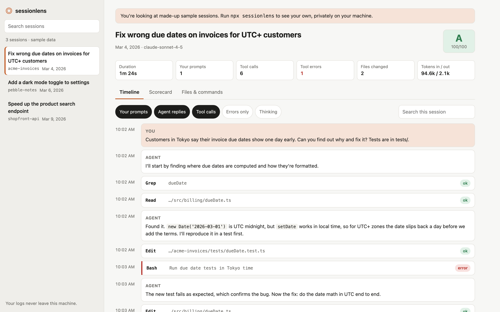

# sessionlens

**See what your AI coding agent actually did.**

sessionlens turns Claude Code session logs into a readable timeline: every prompt, reply, tool call, command, file edit and error, in order. A scorecard then checks *how* the agent worked: did it test its changes, keep you informed, own its mistakes and wrap up clearly?

It runs entirely on your machine. Your logs are never uploaded.

```bash
npx sessionlens
```



[Try the live demo](https://msatghar.github.io/sessionlens/) (made-up sample sessions, nothing real).

## Why

Coding agents now run for minutes at a time and make dozens of tool calls. When something goes wrong, or goes surprisingly right, the only record is a large log file that nobody reads. sessionlens makes that record easy to review, so you can:

- Find the exact command or edit where a session went off track
- See which files changed and which commands ran, in one place
- Spot sessions where the agent changed code without running tests
- Compare how an agent handles errors across sessions

## The scorecard

Four checks, each answered from the log with evidence you can click through to:

| Check | What it asks |
| --- | --- |
| Checked its own work | After the last code change, did it run tests, a build or a type check? |
| Kept you in the loop | Did it explain what it was doing, or make long silent runs of tool calls? |
| Owned its errors | When a tool failed, did it say so instead of quietly moving on? |
| Wrapped up clearly | Did it end with a summary, or stop mid task? |

Checks that don't apply (for example, no code was changed) are marked as such and left out of the grade. These are deliberately simple, transparent heuristics: a starting point for review, not a verdict on code quality.

## Privacy

- The server listens on `127.0.0.1` only and rejects requests addressed to any other host.
- It makes no outbound network requests and has no analytics.
- File paths stay on the server; the browser only sees opaque ids.
- Logs are read from disk when you open them, and nothing is written anywhere.

## Usage

```bash
npx sessionlens                 # reads ~/.claude/projects and opens your browser
npx sessionlens --dir ./logs    # use a different folder
npx sessionlens --port 5000 --no-open
```

Requires Node 18 or newer.

## Development

```bash
npm install
npm run dev        # UI with sample sessions at http://localhost:5173
npm test           # parser, scorecard and server tests
npm run build && npm start
```

The parser (`src/lib/parse.ts`) is tolerant by design: unknown entry types are ignored and half-written lines are skipped and counted, so it keeps working as the log format evolves.

## Roadmap

- Compare two sessions side by side
- Export a session as a shareable, redacted report
- Cost estimates per session
- Custom scorecard rules

## How it was built

Built with Claude Code, which felt fitting for a tool that reviews Claude Code sessions. The scorecard checks come from hands-on experience evaluating coding agent transcripts.

## License

MIT
